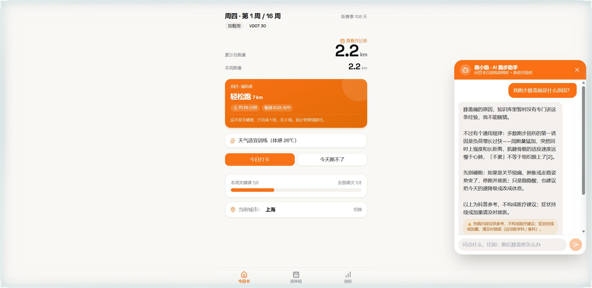
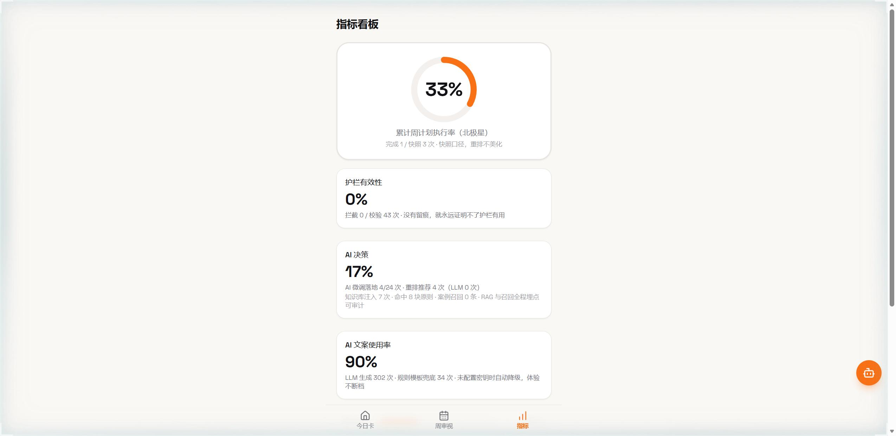
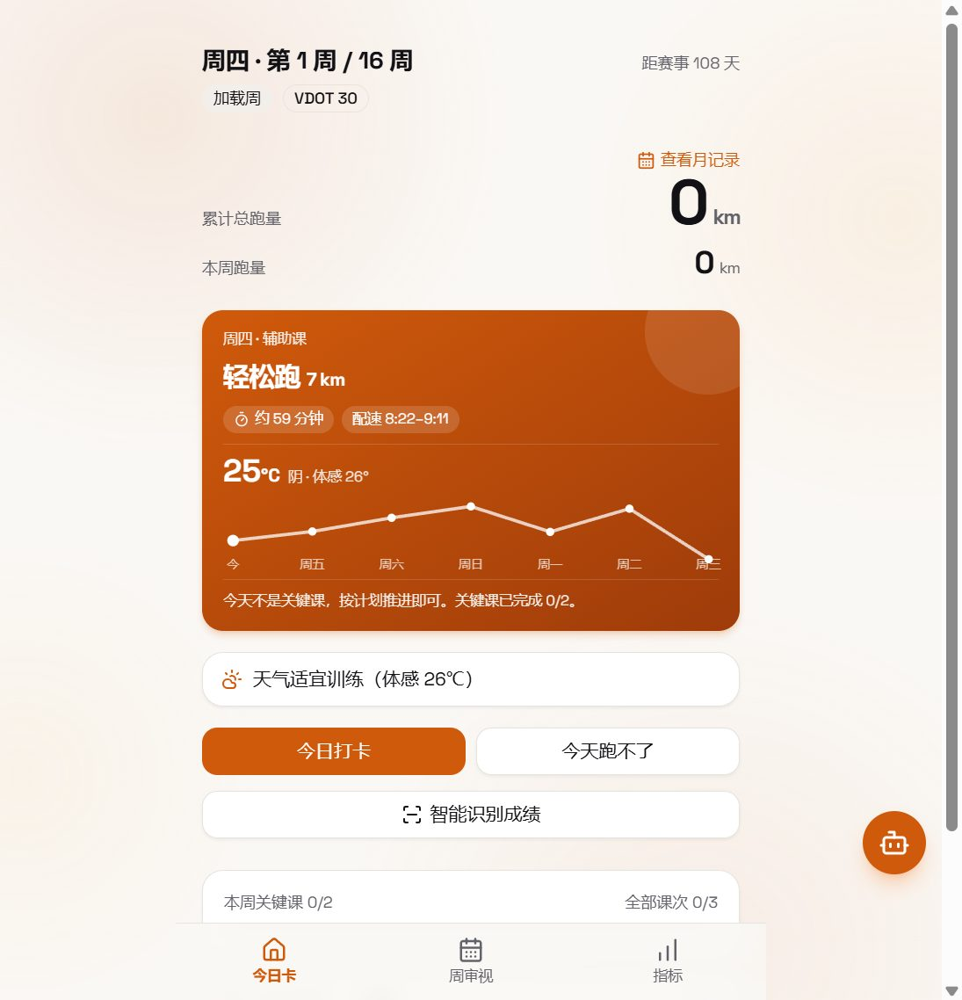
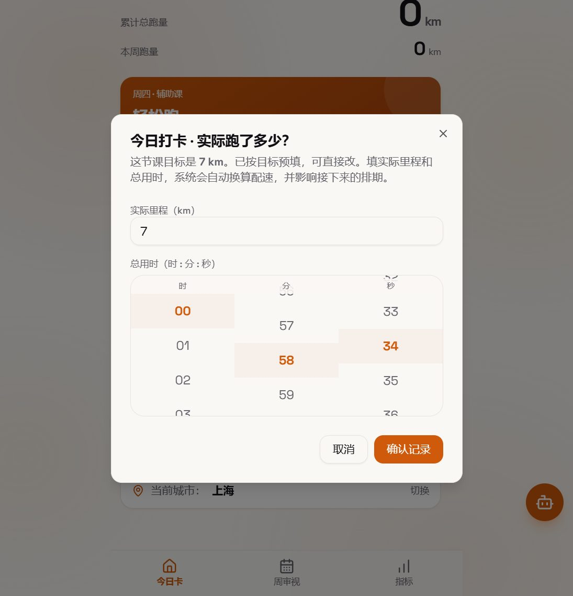
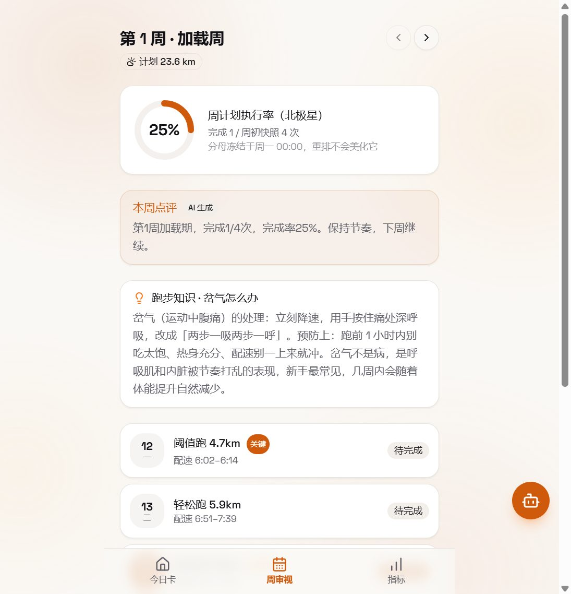
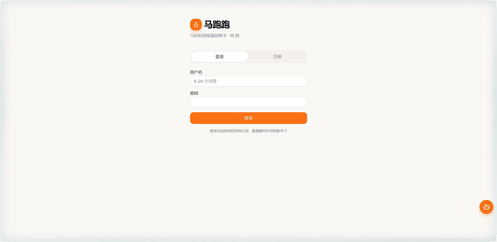

# 马跑跑 · AI 马拉松训练规划助手

> 面向校园马拉松新人的 AI 训练教练：不用懂训练学、不用买运动手表，拍一张成绩单，AI 帮你把 16 周课表排好、讲明白、跟着身体状态动态调。

**规则引擎为主、LLM 为辅，数值计算确定性，模型输出必验尸** —— 这是本产品从第一天起的技术立场，也是它和其他"AI 跑步应用"最大的区别。

## 产品背景：为什么做马跑跑

校园马拉松社团的新人面临三个真实痛点：

| 现有方案 | 问题 |
| --- | --- |
| Nike Run Club / Garmin Coach 等跑表原生软件 | 与自家硬件强绑定，训练逻辑黑盒，新手看不懂"为什么今天跑这个" |
| 传统书籍 + 手动计算（如 Daniels VDOT 经典体系） | 知识门槛高，查表、算配速、排周期全靠手，计划一被天气/伤病打断就全盘作废 |
| 通用 AI 聊天工具 | 数值瞎编、没有护栏，训练量错误直接造成运动损伤，不敢信 |

**马跑跑的定位**：把 Daniels VDOT 训练体系的科学性留下，把门槛和硬件依赖去掉——低知识成本入门、动态维护计划、无智能硬件依赖。

## 核心产品亮点（AI PM 视角）

### 1. 智能识别成绩：拍个照，计划重新排

新手不知道自己跑力几何，是训练计划失效的第一大原因。上传成绩单 / 手表 / 跑步 App 截图，视觉模型读出距离与总用时，折算成 VDOT 跑力值，确认后自动重排后续训练——**AI 只负责读图，数值校验全部在代码里完成**（量纲、区间、配速合理性断言），识别不过一律拒用、引导手动输入。


### 2. 跑小助：带出处、有边界、懂上下文的 AI 助手

不是通用聊天框，是挂在内置跑步知识库上的 RAG 助手：回答逐条标注知识库出处编号，伤病类问题自动挂"科普参考、必要时就医"提示，指代型追问（"那我今天还能跑吗"）能衔接上文。**知识库没覆盖的问题明确说不知道，不编造**。



### 3. AI 微调：在硬边界内动课表

每周首次打开今日卡，AI 结合本周课表、天气硬约束、身体状态反馈提出微调建议——只允许"非关键课挪日子 / 非关键课跑量 ±10%"两种操作，关键课禁动、周总量变化 ≤3%、每周最多 3 个操作，**任何一条越界整个方案拒收**、自动降级规则模板，体验不断档。被调过的课在周审视页显示「AI 微调」徽标，全程可审计。

### 4. 防幻觉设计：AI 的每次出手都有"验尸官"

训练量的数值错误会直接造成伤害，所以本项目不信任 prompt，只信任校验：

- **解释层**（今日卡原因行 / 周点评 / 重排解释）：LLM 输出逐条过数值断言，输出里每个数字必须存在于规则引擎给定的事实集，编一个数整体作废降级；
- **微调层**：LLM 提案 → 代码硬校验 → 越界拒收，主权在代码；
- **识别层**：视觉模型读数 → 数值断言（配速 1'30"~12'00"/km 等）→ 不过即弃。


### 5. 数据看板：AI 表现可量化、可审计

指标页不是装饰，是 AI 功能的产品化验收：护栏有效性（拦截 / 校验次数）、AI 决策占比（微调 / 推荐 / 召回）、AI 文案使用率（LLM vs 模板兜底），每次调用埋点留痕（source=llm/template），未配密钥自动降级也有记录。



## 界面一览（全部实际运行截图）

| 今日卡（跑量北极星 + 天气 + 打卡） | 打卡弹窗（默认值=今日课，时分秒滚轮） |
| --- | --- |
|  |  |

| 周审视（执行率 + AI 点评 + 跑步知识） | 重排方案（为什么 / 怎么改 · 护栏留痕） |
| --- | --- |
|  |  |

| 登录 / 注册 | 跑小助 · AI 跑步助手 |
| --- | --- |
|  |  |

## AI 能力地图

| 能力 | 落地位置 | 产品价值 | 降级方案 |
| --- | --- | --- | --- |
| 成绩识别 → VDOT | `server/vision/`（视觉模型 + 代码校验） | 零门槛录入真实跑力 | 人话提示 → 手动打卡输入 |
| 解释层文案（4 场景） | `server/explain/`（数值断言防幻觉） | 把训练逻辑讲成人话 | 规则模板文案 |
| 课表微调提案 | `server/tune.py`（±10% / 周 ±3% / 关键课禁动） | 计划跟着天气和身体走 | 微调不生效，原计划继续 |
| RAG 知识检索 | `server/rag.py`（中文 bigram，零外部依赖） | 经验类内容用词多变、需要出处 | 直接引用知识库原文 |
| 案例召回 + Prompt 版本化 | `server/prompts.py` + `ai_case` 表 | 相似情境复用被验证有效的调整，离线评测可回放 | v1 行为兜底 |
| AI 决策推荐（主/备选方案） | 重排预览接口（推荐 + 理由 + 来源埋点） | 降低选择成本 | 用户自己选，不强制 |

主权边界不变：**检索结果只进 prompt 做参考，课表改动一律由代码硬校验把关**。

## 架构

```
交互层  React H5（今日卡 / 周审视 / 指标看板 / 注册登录 / 城市切换） → app/
应用层  FastAPI 接口 + 定时任务（周快照冻结 / 天气刷新）           → server/main.py
知识层  rules（VDOT 查表/配速区间/增幅/80/20）                     → server/knowledge/
        explain（LLM 解释层：4 场景文案 + 数值断言防幻觉）           → server/explain/
        tune（LLM 微调层：非关键课 ±10%、周总量 ±3%、关键课禁动）    → server/tune.py
        vision（LLM 识别层：读图出数 + 数值断言拒幻觉）              → server/vision/
适应层  adapt（候选生成 → 护栏过滤 → 打分排序）                    → server/adapt/
护栏层  guard（三条红线纯函数，独立包，不依赖 adapt）               → server/guard/
数据层  SQLAlchemy（开发默认 SQLite，切库改 MAPAOPAO_DB_URL）
外部    Open-Meteo 天气（体感温度口径 + 失败降级）
        OpenAI 兼容 LLM 网关（DeepSeek / Moonshot 等零改动切换）
```

## 运行

```bash
npm install                 # 根目录（concurrently）
npm --prefix app install    # 前端依赖
python -m venv .venv && .venv/Scripts/pip install fastapi "uvicorn[standard]" sqlalchemy apscheduler httpx pytest pydantic pyyaml python-multipart

npm run dev                 # 同时拉起后端(8000) + 前端(7100)，/v1 /jobs /dev 由 Vite 代理
npm run dev -- --port 7200  # host/port 参数转发给 Vite
npm test                    # 136 个 pytest 用例（规则/护栏/重排锚点/LLM 数值断言/AI 微调边界/成绩识别）
npm run build               # 前端生产构建
```

Windows 也可以直接双击 `start.bat`（自动拉起前后端并打开浏览器），`stop.bat` 关闭。

## 部署上线

```bash
npm --prefix app run build      # 产出静态文件到 app/dist/
npm --prefix app run preview    # 本地验证产物（默认 4173 端口）
```

- **前端**：`app/dist` 是纯静态文件，交给任意静态托管即可（Nginx / Vercel / 宝塔面板）。注意 SPA 路由需配置 fallback：所有 404 路径回退到 `index.html`。
- **Vercel（零配置）**：项目根选 `app/`，`app/vercel.json` 已内置两条路由——`/v1/*`、`/jobs/*` 通过 `${MAPAOPAO_API}` 环境变量代理到线上后端（在 Vercel 项目 Settings → Environment Variables 里设置，例如 `MAPAOPAO_API=https://your-api.example.com`），其余路径回退 `index.html`。后端地址不必写进仓库。
- **后端**：任意支持 ASGI 的主机运行 `uvicorn server.main:app --host 0.0.0.0 --port 8000`，生产库通过环境变量 `MAPAOPAO_DB_URL` 切到 PostgreSQL / MySQL。
- **反向代理**：把 `/v1`、`/jobs` 转发到 8000 端口，静态资源走 dist；前端 `src/lib/api.ts` 里的 API 地址按需改为线上域名。
- **安全提醒**：`.env` 只留在服务器上且权限收紧；生产环境务必关闭 Vite 代理，用 Nginx 统一收口，避免 8000 端口直接对外暴露。

## 接入 LLM（可选，不配也能跑）

复制 `.env.example` 为 `.env`，填入 key 即可（OpenAI 兼容协议，DeepSeek / Kimi 等零改动切换）：

```bash
# 文本 LLM：解释层 / 微调层 / 跑小助
LLM_BASE_URL=https://api.deepseek.com
LLM_API_KEY=sk-你的key
LLM_MODEL=deepseek-flash

# 视觉 LLM：智能识别成绩（DeepSeek 全系不支持图片，需 Moonshot 等视觉模型）
VISION_API_KEY=sk-你的key
# VISION_BASE_URL=https://api.moonshot.cn   # 默认即 Moonshot
# VISION_MODEL=moonshot-v1-8k-vision-preview
```

未配置时所有 AI 能力自动降级：文案用规则模板、微调不生效、识别引导手动输入，**产品功能不断档**，且降级本身也计入「AI 文案使用率」埋点。

### RAG + 案例召回 + Prompt 版本化

用户打卡填入实际训练量后（超额完成 >110% / 不足一半），系统自动触发三层 AI 决策增强：

1. **RAG 知识检索**（`server/rag.py`）：训练学原则切块带标签（超量恢复、10% 增量原则、80/20、缺口处理、伤病康复等），中文 bigram 检索 top-3 注入 prompt——零外部依赖，不引 embedding 服务；
2. **案例召回**（`ai_case` 表）：每次偏差触发都记录「情境 + AI 决策 + 检索上下文」，周末按执行率回填 good/bad；相似情境（同阶段 + 同触发 + 偏差率接近）召回历史案例，AI 优先复用被验证有效的调整；
3. **Prompt 版本化调优**（`server/prompts.py`）：prompt 带版本号（tune_v1/v2）埋点，离线评测 `scripts/eval_tune.py` 回放黄金集对比通过率。

## PRD 关键约束的落点

| PRD 约束 | 实现 |
| --- | --- |
| LLM 不参与任何数值计算 | `server/knowledge/rules.py` 唯一数值来源；数值断言测试兜底 |
| AI 微调不伤及关键课 | `server/tune.py` 硬校验：key 课禁动、±10%、周 ±3%，越界拒收 |
| 缺练不跨周补账 | `template_16w.yaml: compensate_across_week: false`，缺口标记降载不删除 |
| 护栏独立且不可绕过 | `server/guard/` 独立包，CI 式测试 `test_guard_does_not_import_adapt` |
| 执行率分母取周初快照 | `plan_week_snapshot` 表，周一 00:00 冻结，重排不改 |
| 体感温度而非气温 | NOAA Heat Index，`apparent_max(30,40) < 30 <= apparent_max(30,85)` 锚点测试 |
| 天气/LLM 挂掉不阻塞 | STALE + confidence=low；模板文案/规则课表降级 |
| 敢劝降目标 | 连续 3 周关键课 <50% → 三选项（半马/延期/坚持），决定权在用户 |

## 安全说明

- `.env`（含 API key）已被 `.gitignore` 排除，仓库内只有 `.env.example` 占位模板
- 账号密码 PBKDF2-SHA256 哈希存储；接口带登录态校验与注册/登录限流
- 注销账号需密码确认，删除全部个人数据
- 跑小助对话按账号隔离，退出登录即清空本机聊天记录，防止多用户串话
